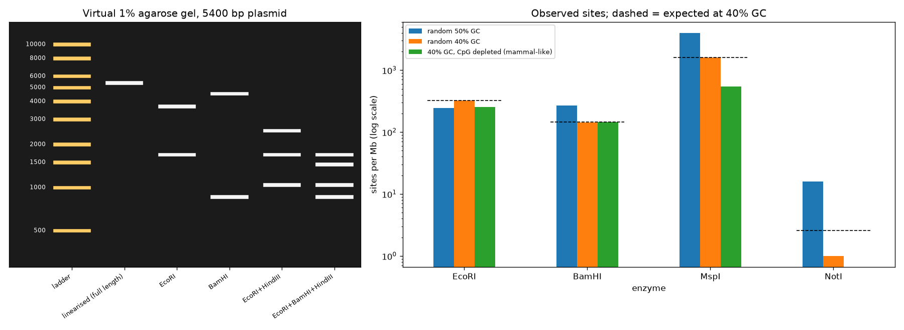

# Restriction Digest Simulator

> Run the gel on your laptop before you run it on the bench.

## Demo Output



Produced from simulated DNA by `demo.py`: single and double digests of a plasmid on a virtual agarose gel, and site frequencies in random versus mammal-like (CpG-depleted) sequence.

## Why This Exists

A diagnostic digest is the cheapest way to check a cloning step, if you know what pattern to expect. This repo finds sites (on linear or circular DNA), computes fragment sizes and draws the gel, with bands placed on a log-size scale the way they run. It also answers a classic exam question: why is NotI a "rare cutter" in mammalian DNA, far rarer than its 8 bp site suggests?

## What's Inside

| Function | Purpose |
|----------|---------|
| `find_sites` | Cut positions for an enzyme, handling sites that span the origin of circular DNA |
| `digest` | Fragment lengths for any combination of enzymes |
| `expected_sites_per_mb` | Expected cuts in random sequence with a given GC content |
| `ENZYMES` | 12 common enzymes with recognition site and cut position |

```python
from digest import digest
digest(plasmid_seq, ["EcoRI", "HindIII"], circular=True)
```

## Rules of Thumb

| Site length | Cuts random DNA every | Use |
|-------------|------------------------|-----|
| 4 bp (MspI, AluI) | ~256 bp | Fingerprinting, RRBS |
| 6 bp (EcoRI, BamHI) | ~4 kb | Cloning, diagnostic digests |
| 8 bp (NotI) | ~65 kb, and far rarer in mammals | Large-fragment mapping |

## When NOT to Use This

- **Methylation-sensitive enzymes** (Dam/Dcm/CpG methylation) can be blocked in vivo. Check your host strain.
- **Star activity and partial digests** aren't modelled. Real gels show them.
- **Fragments under ~100 bp** fall off a 1% gel. Use a higher percentage gel or PAGE.

## The Uncomfortable Truth

Restriction sites are not random in real genomes. CpG depletion makes CG-containing sites (NotI, SmaI, MspI) rare, and AT-rich genomes are full of EcoRI sites. Expectations from 4^n are a starting point, not a prediction.

## Further Reading

- Smith H. O. & Wilcox K. W. "A restriction enzyme from Hemophilus influenzae." Journal of Molecular Biology (1970).
- Bird A. P. "CpG-rich islands and the function of DNA methylation." Nature (1986).
- Roberts R. J. et al. "REBASE — a database for DNA restriction and modification: enzymes, genes and genomes." Nucleic Acids Research (2015).
